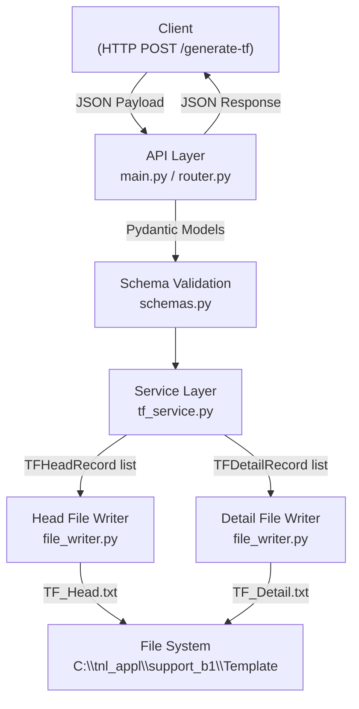
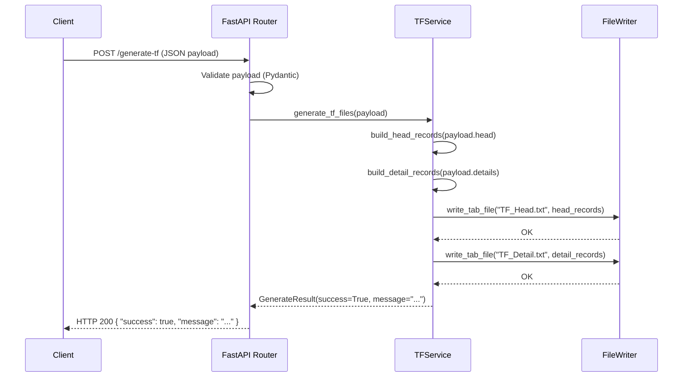
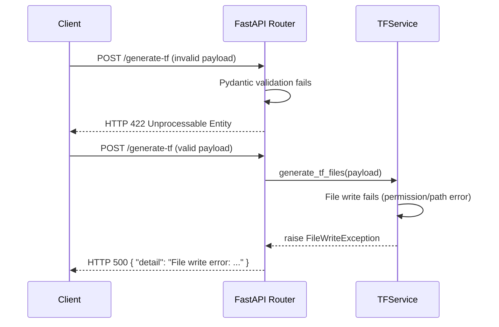

# Design Document: TF File Generator

## Overview

ระบบ FastAPI สำหรับรับ JSON Payload แล้วแปลงและสร้างไฟล์ข้อความแบบ Tab-Delimited 2 ไฟล์ ได้แก่ `TF_Head.txt` และ `TF_Detail.txt` บันทึกลงในโฟลเดอร์ `C:\tnl_appl\support_b1\Template`

ระบบออกแบบโดยใช้หลัก Separation of Concerns แบ่งความรับผิดชอบออกเป็น Layer ชัดเจน ได้แก่ API Layer, Service Layer, File Writer Layer และ Schema/Model Layer เพื่อให้ง่ายต่อการดูแลและทดสอบ

---

## Architecture



---

## Sequence Diagrams

### Main Flow: Generate TF Files



### Error Flow



---

## Components and Interfaces

### Component 1: API Layer (`main.py`, `router.py`)

**Purpose**: รับ HTTP Request, Validate payload, ส่งต่อไปยัง Service Layer และส่ง Response กลับ

**Interface**:
```python
# POST /generate-tf
async def generate_tf(payload: TFPayload) -> GenerateResponse:
    ...
```

**Responsibilities**:
- กำหนด FastAPI application และ route
- รับ JSON payload และ validate ด้วย Pydantic
- เรียก TFService และ handle exceptions
- ส่ง HTTP response กลับ client

---

### Component 2: Schema / Model Layer (`schemas.py`)

**Purpose**: กำหนดโครงสร้างข้อมูล (Pydantic models) สำหรับ request/response และ file record

**Interface**:
```python
class TFHeadInput(BaseModel):
    RecordKey: str
    DocEntry: Optional[str] = ""
    Address: Optional[str] = ""
    CardCode: Optional[str] = ""
    CardName: Optional[str] = ""
    Comments: Optional[str] = ""
    ContactPerson: Optional[str] = ""
    DocDate: Optional[str] = ""
    FromWarehouse: Optional[str] = ""
    JournalMemo: Optional[str] = ""
    PriceList: Optional[str] = ""
    Reference1: Optional[str] = ""
    Reference2: Optional[str] = ""
    SalesPersonCode: Optional[str] = ""
    Series: Optional[str] = ""
    TaxDate: Optional[str] = ""
    DocObjectCode: Optional[str] = ""

class TFDetailInput(BaseModel):
    RecordKey: str
    LineNum: Optional[str] = ""
    Currency: Optional[str] = ""
    DiscountPercent: Optional[str] = ""
    Factor2: Optional[str] = ""
    Factor3: Optional[str] = ""
    Factor4: Optional[str] = ""
    Factor: Optional[str] = ""
    ItemCode: Optional[str] = ""
    ItemDescription: Optional[str] = ""
    Price: Optional[str] = ""
    ProjectCode: Optional[str] = ""
    Quantity: Optional[str] = ""
    Rate: Optional[str] = ""
    SerialNumber: Optional[str] = ""
    VendorNum: Optional[str] = ""
    WarehouseCode: Optional[str] = ""

class TFPayload(BaseModel):
    head: TFHeadInput
    details: List[TFDetailInput]

class GenerateResponse(BaseModel):
    success: bool
    message: str
    files: List[str]
```

**Responsibilities**:
- Validate ข้อมูลที่รับเข้ามาด้วย Pydantic
- กำหนด default value ให้ field ที่ optional (empty string)
- เป็น contract ระหว่าง API Layer และ Service Layer

---

### Component 3: Service Layer (`tf_service.py`)

**Purpose**: Logic หลักของระบบ — แปลง payload เป็น record rows และสั่ง write file

**Interface**:
```python
class TFService:
    def generate_tf_files(self, payload: TFPayload) -> GenerateResponse:
        ...

    def _build_head_rows(self, head: TFHeadInput) -> List[List[str]]:
        ...

    def _build_detail_rows(self, details: List[TFDetailInput]) -> List[List[str]]:
        ...
```

**Responsibilities**:
- แปลง `TFHeadInput` เป็น list of rows (header row + data row)
- แปลง `List[TFDetailInput]` เป็น list of rows (header row + data rows)
- เรียก `FileWriter` สำหรับแต่ละไฟล์
- คืน `GenerateResponse` พร้อม path ของไฟล์ที่สร้าง

---

### Component 4: File Writer Layer (`file_writer.py`)

**Purpose**: รับ rows ข้อมูลและเขียนเป็นไฟล์ Tab-Delimited

**Interface**:
```python
class FileWriter:
    def __init__(self, output_dir: str):
        ...

    def write_tab_file(self, filename: str, rows: List[List[str]]) -> str:
        """
        เขียน rows ลงไฟล์ tab-delimited
        คืน absolute path ของไฟล์ที่เขียน
        """
        ...
```

**Responsibilities**:
- สร้าง output directory หากยังไม่มี
- เขียนแต่ละ row โดยคั่นด้วย `\t` และ line ending `\n`
- Encode ด้วย UTF-8
- คืน path ของไฟล์ที่สร้าง

---

## Data Models

### TF_Head.txt — Column Order

| ลำดับ | Field Name      | ตัวอย่างค่า    |
|------|-----------------|----------------|
| 0    | RecordKey       | RAGTAG         |
| 1    | DocEntry        | (ว่าง)         |
| 2    | Address         | (ว่าง)         |
| 3    | CardCode        | (ว่าง)         |
| 4    | CardName        | (ว่าง)         |
| 5    | Comments        | (ว่าง)         |
| 6    | ContactPerson   | (ว่าง)         |
| 7    | DocDate         | 20260701       |
| 8    | FromWarehouse   | STORE2         |
| 9    | JournalMemo     | Transfer for ใบเกลี่ยโอน |
| 10   | PriceList       | 2              |
| 11   | Reference1      | (ว่าง)         |
| 12   | Reference2      | (ว่าง)         |
| 13   | SalesPersonCode | (ว่าง)         |
| 14   | Series          | 1636           |
| 15   | TaxDate         | (ว่าง)         |
| 16   | DocObjectCode   | 67             |

**Validation Rules**:
- `RecordKey` ต้องไม่ว่าง (required)
- `DocDate` และ `TaxDate` หากมีค่าต้องเป็นรูปแบบ `YYYYMMDD`
- Field อื่นๆ เป็น optional (default = empty string)

---

### TF_Detail.txt — Column Order

| ลำดับ | Field Name      | ตัวอย่างค่า    |
|------|-----------------|----------------|
| 0    | RecordKey       | RAGTAG / 1     |
| 1    | LineNum         | 0, 1, 2, 3     |
| 2    | Currency        | (ว่าง)         |
| 3    | DiscountPercent | (ว่าง)         |
| 4    | Factor2         | (ว่าง)         |
| 5    | Factor3         | (ว่าง)         |
| 6    | Factor4         | (ว่าง)         |
| 7    | Factor          | (ว่าง)         |
| 8    | ItemCode        | TH0230226055401 |
| 9    | ItemDescription | (ว่าง)         |
| 10   | Price           | (ว่าง)         |
| 11   | ProjectCode     | (ว่าง)         |
| 12   | Quantity        | 1              |
| 13   | Rate            | (ว่าง)         |
| 14   | SerialNumber    | (ว่าง)         |
| 15   | VendorNum       | (ว่าง)         |
| 16   | WarehouseCode   | INTRAN1        |

**Validation Rules**:
- `RecordKey` ต้องไม่ว่าง (required)
- `ItemCode` ต้องไม่ว่าง (required)
- `Quantity` หากมีค่าต้องเป็นตัวเลข
- Field อื่นๆ เป็น optional (default = empty string)

---

## Key Functions with Formal Specifications

### `TFService.generate_tf_files(payload)`

```python
def generate_tf_files(self, payload: TFPayload) -> GenerateResponse:
```

**Preconditions:**
- `payload.head.RecordKey` is non-empty string
- `payload.details` is a list with at least one item
- Each `detail.RecordKey` is non-empty string
- Each `detail.ItemCode` is non-empty string

**Postconditions:**
- `TF_Head.txt` is written to output directory with header row + 1 data row
- `TF_Detail.txt` is written to output directory with header row + N data rows (N = len(details))
- Returns `GenerateResponse` with `success=True` and `files` list containing both file paths
- If write fails, raises `FileWriteException` (no partial file left behind)

**Loop Invariants:** N/A (delegates iteration to sub-methods)

---

### `TFService._build_head_rows(head)`

```python
def _build_head_rows(self, head: TFHeadInput) -> List[List[str]]:
```

**Preconditions:**
- `head` is a valid `TFHeadInput` instance

**Postconditions:**
- Returns a list of exactly 2 rows: `[header_row, data_row]`
- `header_row` = `[field_name, ...]` in canonical column order (17 columns)
- `data_row` = `[field_value, ...]` matching the same column order
- All values are strings (None converted to `""`)

---

### `TFService._build_detail_rows(details)`

```python
def _build_detail_rows(self, details: List[TFDetailInput]) -> List[List[str]]:
```

**Preconditions:**
- `details` is a non-empty list of valid `TFDetailInput` instances

**Postconditions:**
- Returns a list of `1 + len(details)` rows: `[header_row, data_row_0, ..., data_row_N]`
- `header_row` = `[field_name, ...]` in canonical column order (17 columns)
- Each `data_row` = `[field_value, ...]` matching the same column order
- All values are strings

**Loop Invariants:**
- For each iteration `i` over `details`: rows[i+1] corresponds to `details[i]`
- All appended rows have exactly 17 columns

---

### `FileWriter.write_tab_file(filename, rows)`

```python
def write_tab_file(self, filename: str, rows: List[List[str]]) -> str:
```

**Preconditions:**
- `filename` is non-empty string with `.txt` extension
- `rows` is a non-empty list of lists
- Each inner list contains only string values

**Postconditions:**
- File is created/overwritten at `{output_dir}/{filename}`
- Each row is joined by `\t` and terminated by `\n`
- File encoding is UTF-8
- Returns the absolute path of the written file as string

---

## Algorithmic Pseudocode

### Main Processing Algorithm

```python
ALGORITHM generate_tf_files(payload: TFPayload) -> GenerateResponse

BEGIN
    head_rows    = _build_head_rows(payload.head)
    detail_rows  = _build_detail_rows(payload.details)

    TRY
        head_path   = writer.write_tab_file("TF_Head.txt",   head_rows)
        detail_path = writer.write_tab_file("TF_Detail.txt", detail_rows)
    EXCEPT IOError AS e
        RAISE FileWriteException(str(e))

    RETURN GenerateResponse(
        success = True,
        message = "Files generated successfully",
        files   = [head_path, detail_path]
    )
END
```

### Build Head Rows Algorithm

```python
ALGORITHM _build_head_rows(head: TFHeadInput) -> List[List[str]]

COLUMNS = [
    "RecordKey", "DocEntry", "Address", "CardCode", "CardName",
    "Comments", "ContactPerson", "DocDate", "FromWarehouse", "JournalMemo",
    "PriceList", "Reference1", "Reference2", "SalesPersonCode", "Series",
    "TaxDate", "DocObjectCode"
]

BEGIN
    header_row = COLUMNS
    data_row   = [getattr(head, col, "") or "" FOR col IN COLUMNS]
    RETURN [header_row, data_row]
END
```

### Build Detail Rows Algorithm

```python
ALGORITHM _build_detail_rows(details: List[TFDetailInput]) -> List[List[str]]

COLUMNS = [
    "RecordKey", "LineNum", "Currency", "DiscountPercent",
    "Factor2", "Factor3", "Factor4", "Factor",
    "ItemCode", "ItemDescription", "Price", "ProjectCode",
    "Quantity", "Rate", "SerialNumber", "VendorNum", "WarehouseCode"
]

BEGIN
    rows = [COLUMNS]  -- header row

    FOR EACH detail IN details DO
        -- INVARIANT: all rows appended so far have exactly 17 columns
        data_row = [getattr(detail, col, "") or "" FOR col IN COLUMNS]
        ASSERT len(data_row) == 17
        rows.append(data_row)
    END FOR

    RETURN rows
END
```

### Write Tab File Algorithm

```python
ALGORITHM write_tab_file(filename: str, rows: List[List[str]]) -> str

BEGIN
    os.makedirs(output_dir, exist_ok=True)
    filepath = os.path.join(output_dir, filename)

    OPEN filepath WITH encoding="utf-8", mode="w" AS f DO
        FOR EACH row IN rows DO
            line = "\t".join(row)
            f.write(line + "\n")
        END FOR
    END OPEN

    RETURN os.path.abspath(filepath)
END
```

---

## Example Usage

```python
# Example payload (Python dict equivalent of JSON request body)
payload_json = {
    "head": {
        "RecordKey": "RAGTAG",
        "DocDate": "20260701",
        "FromWarehouse": "STORE2",
        "JournalMemo": "Transfer for ใบเกลี่ยโอน",
        "PriceList": "2",
        "Series": "1636",
        "DocObjectCode": "67"
    },
    "details": [
        {"RecordKey": "RAGTAG", "LineNum": "0", "ItemCode": "TH0230226055401", "Quantity": "1", "WarehouseCode": "INTRAN1"},
        {"RecordKey": "1",      "LineNum": "1", "ItemCode": "TH0230226066978", "Quantity": "1", "WarehouseCode": "INTRAN1"},
        {"RecordKey": "1",      "LineNum": "2", "ItemCode": "TH0232125122229", "Quantity": "1", "WarehouseCode": "INTRAN1"},
        {"RecordKey": "1",      "LineNum": "3", "ItemCode": "TH0232125122291", "Quantity": "1", "WarehouseCode": "INTRAN1"}
    ]
}

# cURL equivalent
# curl -X POST http://localhost:8000/generate-tf \
#      -H "Content-Type: application/json" \
#      -d @payload.json

# Expected TF_Head.txt output (tab-delimited):
# RecordKey\tDocEntry\t...\tDocObjectCode
# RAGTAG\t\t\t\t\t\t\t20260701\tSTORE2\tTransfer for ใบเกลี่ยโอน\t2\t\t\t\t1636\t\t67

# Expected TF_Detail.txt output (tab-delimited):
# RecordKey\tLineNum\t...\tWarehouseCode
# RAGTAG\t0\t\t\t\t\t\t\tTH0230226055401\t\t\t\t1\t\t\t\tINTRAN1
# 1\t1\t\t\t\t\t\t\tTH0230226066978\t\t\t\t1\t\t\t\tINTRAN1
# ...
```

---

## Error Handling

### Error Scenario 1: Validation Error (Invalid Payload)

**Condition**: JSON payload ขาด required field หรือ field มีประเภทผิด  
**Response**: HTTP 422 Unprocessable Entity พร้อม Pydantic error detail  
**Recovery**: Client ต้องแก้ไข payload และส่งใหม่

### Error Scenario 2: File Write Permission Error

**Condition**: ไม่มีสิทธิ์เขียนไฟล์ที่ `C:\tnl_appl\support_b1\Template`  
**Response**: HTTP 500 `{ "detail": "File write error: [Errno 13] Permission denied" }`  
**Recovery**: ตรวจสอบ permission ของ folder หรือเปลี่ยน output directory ใน config

### Error Scenario 3: Output Directory ไม่มีอยู่

**Condition**: Path `C:\tnl_appl\support_b1\Template` ไม่ได้ถูกสร้างไว้  
**Response**: `FileWriter.write_tab_file()` จะสร้าง directory อัตโนมัติด้วย `os.makedirs(..., exist_ok=True)`  
**Recovery**: ระบบ handle อัตโนมัติ ไม่ต้อง manual intervention

### Error Scenario 4: Empty Details List

**Condition**: `payload.details` เป็น list ว่าง  
**Response**: HTTP 422 จาก Pydantic validation (`min_length=1`)  
**Recovery**: Client ต้องส่ง detail อย่างน้อย 1 รายการ

---

## Testing Strategy

### Unit Testing Approach

ทดสอบแต่ละ component แยกกันโดยใช้ `pytest`:

- `test_schemas.py` — ทดสอบ Pydantic validation (valid/invalid payloads)
- `test_tf_service.py` — ทดสอบ `_build_head_rows` และ `_build_detail_rows` (correct column order, default values)
- `test_file_writer.py` — ทดสอบ `write_tab_file` ด้วย temp directory (ใช้ `tmp_path` fixture)

### Integration Testing Approach

ใช้ FastAPI `TestClient` สำหรับ end-to-end test:

- `test_api.py` — POST `/generate-tf` ด้วย valid payload แล้วตรวจสอบไฟล์ที่ถูกสร้างขึ้น
- ใช้ `tmp_path` override output directory ใน test environment

### Manual Test Runner

ไฟล์ `test_runner.py` สำหรับส่ง real HTTP request ไปยัง running server:

```python
# test_runner.py
import requests, json

payload = {
    "head": { "RecordKey": "RAGTAG", "DocDate": "20260701", ... },
    "details": [ { "RecordKey": "RAGTAG", "LineNum": "0", ... }, ... ]
}
response = requests.post("http://localhost:8000/generate-tf", json=payload)
print(response.status_code, response.json())
```

---

## Project Structure

```
tf-file-generator/
├── main.py               # FastAPI app entry point
├── router.py             # API routes definition
├── schemas.py            # Pydantic request/response models
├── tf_service.py         # Business logic: build rows, orchestrate file writes
├── file_writer.py        # File I/O: write tab-delimited files
├── config.py             # Configuration (output directory path)
├── requirements.txt      # Python dependencies
├── test_runner.py        # Manual test script (sends HTTP request)
└── tests/
    ├── test_schemas.py
    ├── test_tf_service.py
    ├── test_file_writer.py
    └── test_api.py
```

---

## Performance Considerations

- รองรับ payload ขนาดเล็กถึงกลาง (detail rows หลักร้อยรายการ) ได้โดยไม่มีปัญหา
- สำหรับ payload ขนาดใหญ่ (detail > 10,000 rows) ควรพิจารณา streaming write แทน in-memory list
- FastAPI รองรับ async I/O แต่ file write ทำแบบ synchronous — หากต้องการ scale ควรใช้ `asyncio.to_thread()`

## Security Considerations

- `output_dir` ถูก hardcode จาก config ไม่ได้รับจาก client โดยตรง เพื่อป้องกัน path traversal attack
- ไม่มี authentication ในเวอร์ชันแรก — หากใช้ใน production ควรเพิ่ม API Key หรือ OAuth2
- Filename (`TF_Head.txt`, `TF_Detail.txt`) ถูก hardcode ไม่ได้รับจาก client

## Dependencies

```
fastapi>=0.111.0
uvicorn[standard]>=0.29.0
pydantic>=2.0.0
requests>=2.31.0   # สำหรับ test_runner.py
pytest>=8.0.0
httpx>=0.27.0      # สำหรับ FastAPI TestClient
```
