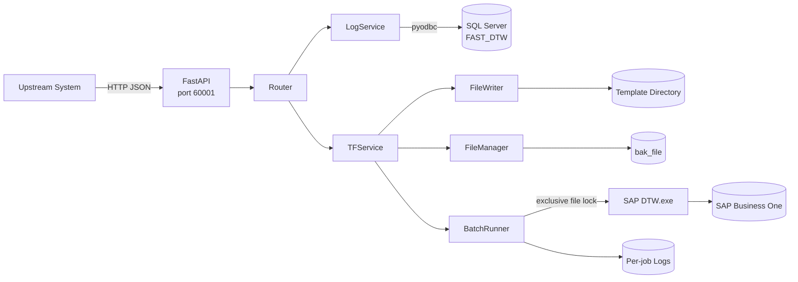
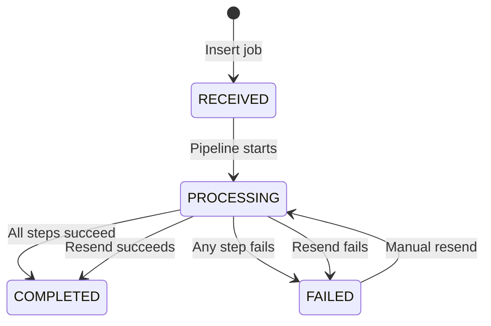
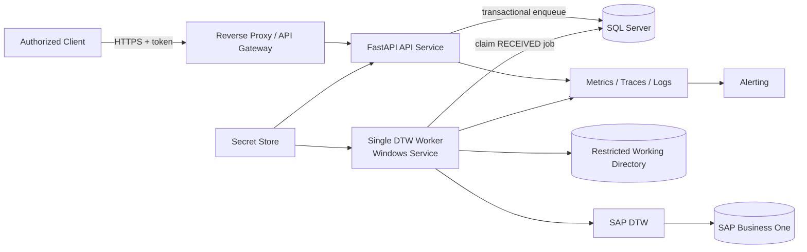
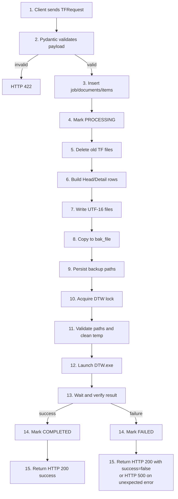
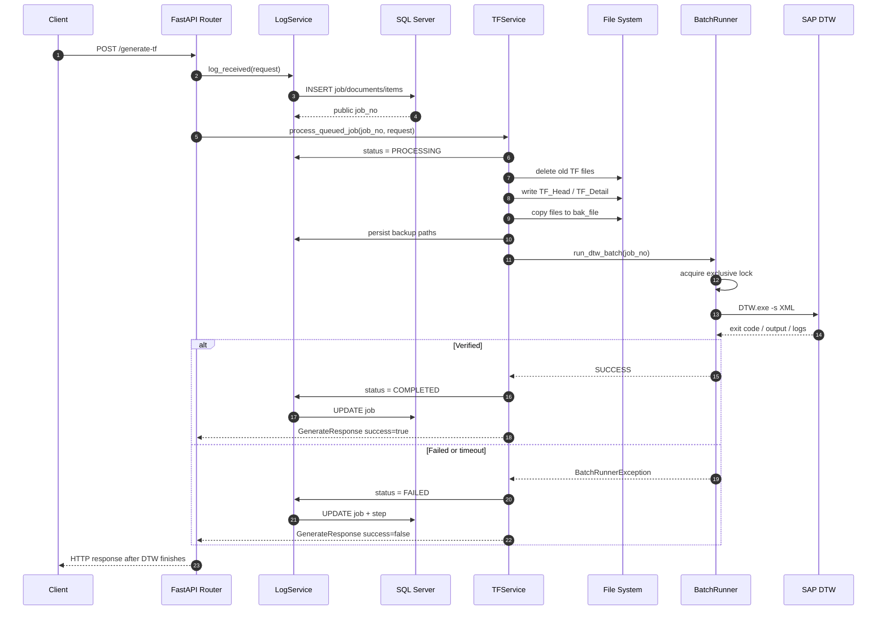
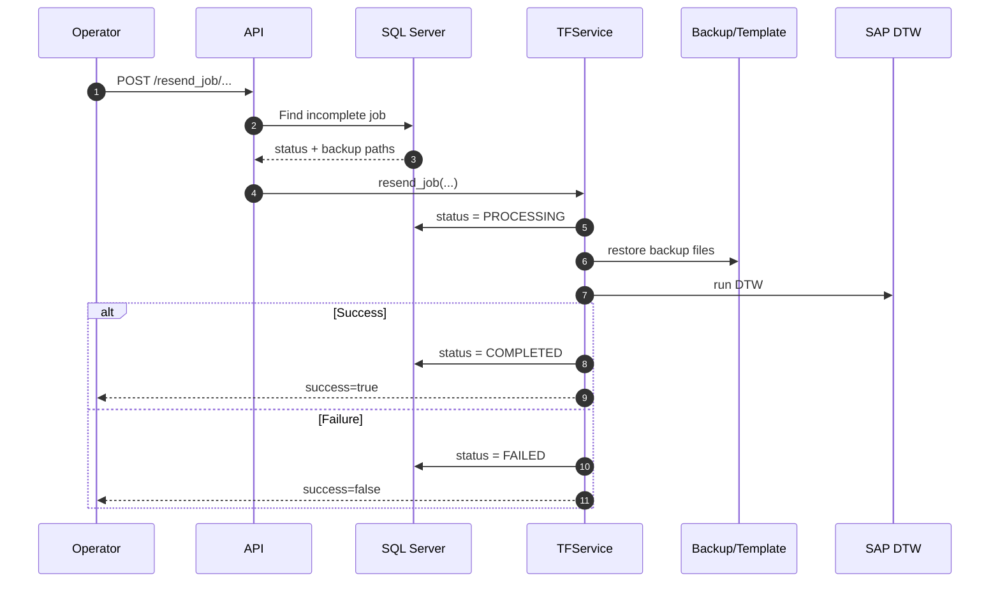
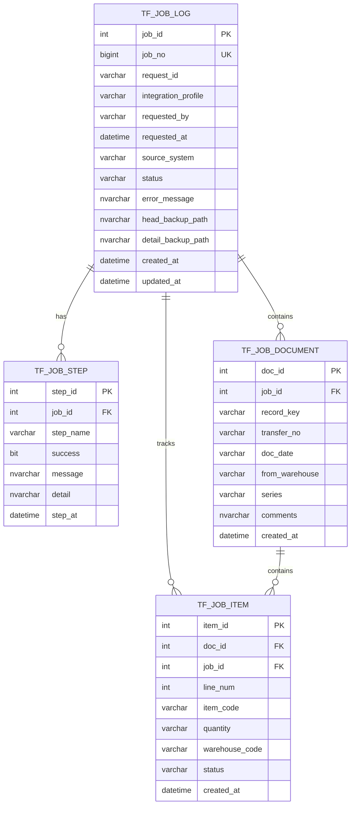
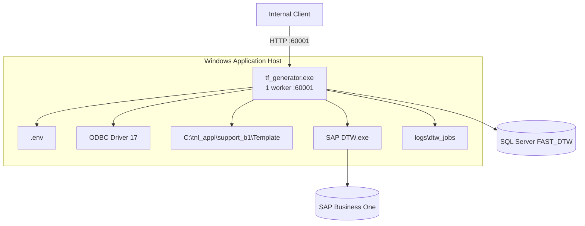
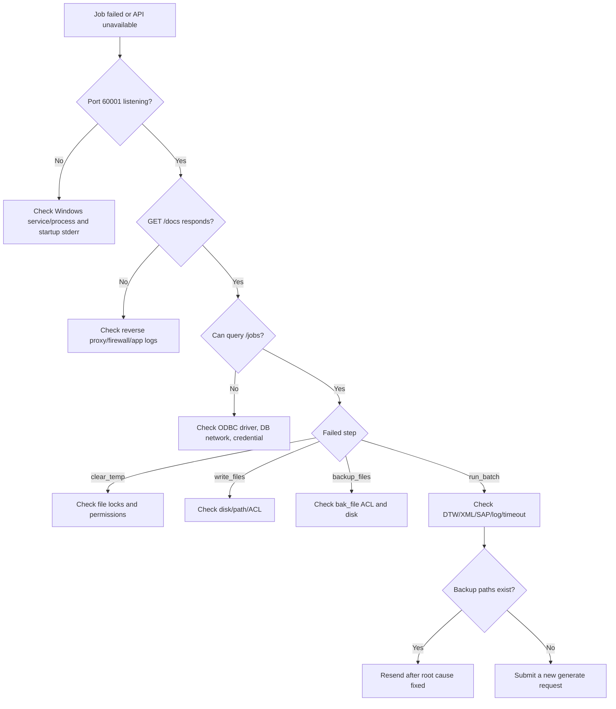

# TF File Generator — Production System Documentation

> เวอร์ชันเอกสาร: 1.0  
> วันที่วิเคราะห์: 2026-07-27  
> ขอบเขต: Source code commit `38cceb3`  
> สถานะเอกสาร: As-Is Architecture + Production Target + Operations Runbook  
> เจ้าของระบบ: ระบุโดยทีม Application / SAP Integration

---

## Document Control

| รายการ | ค่า |
|---|---|
| System | TF File Generator |
| Application type | Windows-hosted Python/FastAPI integration service |
| Primary integration | SAP Business One Data Transfer Workbench (DTW) |
| Database | Microsoft SQL Server, database `FAST_DTW` |
| Runtime | Python หรือ PyInstaller single-file executable |
| Listening endpoint ตาม source code | `0.0.0.0:60001` |
| Default process count ตาม source code | 1 worker |
| API specification | `/docs`, `/redoc`, `/openapi.json` |
| Configuration | Environment variables / `.env` |
| Primary output | `TF_Head.txt`, `TF_Detail.txt` |

> [!IMPORTANT]
> เอกสารนี้ใช้ source code เป็น Source of Truth ค่าใน `BUILD_README.md` ที่ระบุ port `60000` และ 4 workers ไม่ตรงกับ `main.py` ปัจจุบัน ซึ่งใช้ port `60001` และ 1 worker

> [!WARNING]
> ระบบปัจจุบันยังไม่ผ่านเกณฑ์ Production Grade เต็มรูปแบบ โดยเฉพาะ Authentication, Secret Management, Durable Queue, Health Check, Metrics, Idempotency และการจัดการไฟล์/credentials ใน Git รายละเอียดอยู่ในหัวข้อ Security Design และ Production Readiness Gaps

---

# 1. Executive Summary

TF File Generator เป็น integration service ที่รับคำขอโอนสินค้าในรูป JSON สร้างไฟล์ tab-delimited แบบ UTF-16 สำหรับ SAP Business One จากนั้นสำรองไฟล์ เรียก SAP Data Transfer Workbench และบันทึกสถานะงานลง SQL Server

Business flow หลักคือ:

1. รับ transfer request ผ่าน FastAPI
2. สร้าง job และรายละเอียด document/item ในฐานข้อมูล
3. ลบไฟล์ TF เดิมใน Template directory
4. สร้าง `TF_Head.txt` และ `TF_Detail.txt`
5. สำรองไฟล์เข้า `bak_file`
6. เรียก `DTW.exe -s <xml-param>`
7. ตรวจ exit code, stdout/stderr และ optional DTW logs
8. อัปเดต job เป็น `COMPLETED` หรือ `FAILED`
9. รองรับการค้นหาและ resend งานที่ไม่สำเร็จ

สถานะปัจจุบัน:

| มิติ | Assessment |
|---|---|
| Functional correctness | ชุดทดสอบผ่าน 74 tests |
| Processing model | HTTP request รอ pipeline จบแบบ synchronous |
| Concurrency | DTW ถูก serialize ด้วย system-wide file lock |
| Recoverability | มี backup และ resend แต่ไม่มี durable queue/recovery อัตโนมัติ |
| Availability | Single Windows host, single application worker |
| Observability | มี DB job/step logs และ per-job file logs แต่ไม่มี metrics/alerts |
| Security | ไม่มี authentication/authorization; พบ `.env`, binary และ operational logs ถูก track ใน Git |
| Deployment | Manual build/deploy ด้วย PyInstaller; ไม่มี CI/CD หรือ service manifest ใน repository |

คำแนะนำก่อน Production:

- หมุนเวียน DB credential ทันทีและลบ secret ออกจาก Git history
- วาง API หลัง TLS reverse proxy/API gateway และบังคับ authentication
- ทำ API contract ให้ชัดเจนเรื่อง `job_id` กับ `job_no`
- เปลี่ยนเป็น durable DB-backed queue หรือ external broker
- เพิ่ม `/health/live`, `/health/ready`, metrics และ alerting
- ทำ deployment เป็น Windows Service พร้อม least-privilege service account
- เพิ่ม idempotency ด้วย unique `request_id`

---

# 2. Business Purpose

## 2.1 วัตถุประสงค์

ลดงาน manual ในการนำข้อมูล Stock Transfer จาก upstream system เข้า SAP Business One โดยแปลง payload ให้เป็นรูปแบบไฟล์ที่ DTW รองรับ และเพิ่มความสามารถในการติดตาม ตรวจสอบ และส่งงานซ้ำ

## 2.2 Business Capabilities

- รับคำขอโอนสินค้าหลาย document และหลาย item ต่อ request
- สร้างไฟล์ DTW ตาม column order ที่ระบบ SAP คาดหวัง
- เก็บ audit trail ระดับ job, document, item และ processing step
- ค้นหาประวัติด้วย item code
- ค้นหา job แบบ pagination และ status/date filters
- resend งานที่ไม่สำเร็จจาก backup เดิม
- ตรวจผล DTW จาก process exit code และข้อความ error ใน logs

## 2.3 ผู้เกี่ยวข้อง

| Stakeholder | ความรับผิดชอบ |
|---|---|
| Upstream Application | ส่ง request ที่ถูกต้องและมี `request_id` |
| Application Support | ตรวจ job, logs, resend และ incident triage |
| SAP/B1 Team | ดูแล DTW, XML parameter, SAP connectivity และ import rules |
| DBA | ดูแล `FAST_DTW`, backup, permissions และ performance |
| Infrastructure | ดูแล Windows host, service, disk, network และ certificates |
| Security | ดูแล credentials, API access, audit และ vulnerability management |

## 2.4 Success Criteria ที่แนะนำ

- Successful import rate ≥ 99.5% ต่อวัน โดยไม่นับ validation errors จาก client
- API availability ≥ 99.9% ใน business hours
- 95th percentile queue wait < 2 นาที
- ไม่มี job ค้าง `PROCESSING` เกิน `TF_DTW_TIMEOUT_SECONDS + 5 นาที`
- MTTD < 5 นาที และ MTTR < 30 นาทีสำหรับ service failure
- ทุก request มี correlation ระหว่าง `request_id`, public `job_no`, internal `job_id` และ DTW log

---

# 3. System Architecture

## 3.1 As-Is Architecture



## 3.2 Runtime Behavior ที่ต้องเข้าใจ

- `main.py` เริ่ม FastAPI และ background `queue_manager.worker_loop`
- อย่างไรก็ตาม `POST /generate-tf` ไม่ได้เรียก `enqueue_job`; endpoint เรียก `process_queued_job` ผ่าน thread pool และรอจน pipeline จบ
- ดังนั้นชื่อ method และ OpenAPI description ที่ระบุ “queued/background” ไม่ตรงกับ runtime จริง
- DTW execution ถูก serialize ข้าม process ด้วย lock file `%TEMP%\dtw_run.lock`
- System temp cleanup ถูกเปิดเป็นค่า default ก่อนเริ่ม DTW และมี lock แยก `%TEMP%\temp_cleanup.lock`
- API routes ไม่มี `/api/DTW_Service` prefix ใน source code ปัจจุบัน

## 3.3 Job State Model



## 3.4 Production Target Architecture



Target design แยก API intake ออกจาก DTW worker เพื่อให้ HTTP ตอบ `202 Accepted` ได้เร็ว งานไม่สูญหายเมื่อ process restart และ scale API ได้โดยไม่รัน DTW พร้อมกัน

---

# 4. Service Components

| Component | File | Responsibility | Production Notes |
|---|---|---|---|
| Application entry | `main.py` | FastAPI lifecycle, socket binding, process startup | Port/worker hard-coded; shutdown ไม่ cancel worker task |
| API router | `router.py` | Generate, status, list, detail, resend | ไม่มี route prefix/auth/rate limit |
| Schemas | `schemas.py` | Pydantic request/response validation | หลาย field เป็น optional/default empty; date/quantity validation จำกัด |
| TF orchestration | `tf_service.py` | Clear, write, backup, run DTW, resend | Main pipeline synchronous |
| File writer | `file_writer.py` | UTF-16 tab-delimited, CRLF output | เขียนทับชื่อไฟล์คงที่ |
| File manager | `file_manager.py` | Cleanup, backup, restore | Backup timestampละเอียดระดับวินาที อาจชนกันได้ |
| DTW runner | `batch_runner.py` | Validate, clean temp, lock, launch, wait, verify, log | มี timeout และ lock; default ลบ system temp |
| Job logger | `log_service.py` | Persist lifecycle to SQL Server | ใช้ connection เดียวระยะยาวและ swallow DB errors |
| DB connection | `db/connection.py` | pyodbc connection factory | SQL login + `TrustServerCertificate=yes` |
| DB repository | `db/log_repository.py` | CRUD job/step/document/item | หลาย insert commit ทีละ row; ไม่มี transaction ครอบทั้ง request |
| Queue manager | `queue_manager.py` | In-process asyncio queue | ถูก start แต่ generate endpoint ไม่ได้ enqueue |
| Build package | `tf_generator.spec`, `build.bat` | PyInstaller executable | Manual build; `.env` ถูก copy ไป `dist` |

## 4.1 File Format

- Encoding: UTF-16 พร้อม BOM
- Delimiter: Tab (`\t`)
- Line ending: CRLF
- Files: `TF_Head.txt`, `TF_Detail.txt`
- Row 1: column headers
- Row 2: integration profile marker
- Rows ถัดไป: document/detail data

## 4.2 Status Layers

ระบบมี status สองชุด:

- Business job status ใน SQL: `RECEIVED`, `PROCESSING`, `COMPLETED`, `FAILED`
- DTW runner status ใน memory/log: `VALIDATING`, `CLEAN_TEMP`, `START_DTW`, `DTW_RUNNING`, `WAITING_IMPORT`, `VERIFY_RESULT`, `SUCCESS`, `FAILED`

`tf_job_item.status` มี default `PROCESSING` แต่ source code ปัจจุบันไม่พบการอัปเดต item status เป็น `COMPLETED` ดังนั้นผู้ใช้งานควรอ้างอิง `job_status` เป็นหลักจนกว่าจะแก้ implementation

---

# 5. Data Flow Diagram



## 5.1 Data Classification

| Data | Source | Destination | Sensitivity |
|---|---|---|---|
| Request metadata | Upstream | SQL Server | Internal |
| Item/warehouse/quantity | Upstream | SQL + TF files + backups | Business confidential |
| DB credential | Environment/`.env` | pyodbc | Secret |
| SAP/DTW config | Environment/filesystem | DTW | Restricted configuration |
| Error details | DTW/process | DB + log files + API step detail | Potentially sensitive |

---

# 6. Sequence Diagram

## 6.1 Generate TF — Current Synchronous Flow



## 6.2 Resend Flow



---

# 7. API Documentation Summary

## 7.1 Base URL

```text
http://<host>:60001
```

Source code ปัจจุบันไม่มี `/api/DTW_Service` prefix หากมี reverse proxy เพิ่ม prefix ต้องบันทึกไว้ใน deployment configuration

## 7.2 Endpoints

| Method | Path | Purpose | Success | Notes |
|---|---|---|---|---|
| POST | `/generate-tf` | สร้างไฟล์และรัน DTW | 200 | Synchronous; อาจรอถึง timeout 1800s |
| GET | `/status/item_code/{item_code}` | ประวัติ item | 200 | ไม่พบข้อมูลคืน `records=[]` |
| GET | `/jobs` | รายการ job | 200 | filter/pagination |
| GET | `/jobs/{job_id}` | รายละเอียด job | 200 | Implementation ค้น internal `job_id` |
| POST | `/resend_job/item_code/{item_code}` | resend incomplete job ล่าสุดของ item | 200 | ต้องมี backup paths |
| POST | `/resend_job/request_id/{request_id}` | resend incomplete job ล่าสุดของ request | 200 | ต้องมี backup paths |
| POST | `/resend_job/job/{job_id}` | resend ด้วย internal DB identity | 200 | ไม่รับ completed job |
| POST | `/resend_job/job_no/{job_no}` | resend ด้วย public `YYYYMMDD###` | 200 | แนะนำ endpoint นี้สำหรับ client |

## 7.3 Identifier Contract

| Identifier | Example | Storage | Usage |
|---|---|---|---|
| Internal job ID | `123` | `tf_job_log.job_id INT IDENTITY` | Foreign keys และ `/resend_job/job/{job_id}` |
| Public job number | `20260714001` | `tf_job_log.job_no BIGINT` | Generate response, lists, public tracking |
| Request ID | UUID/string | `request_id` | Client correlation; ปัจจุบันไม่ unique |

> [!CAUTION]
> Contract ยังไม่สม่ำเสมอ: `/jobs` ส่ง public `job_no` ใน field `job_id` แต่ `GET /jobs/{job_id}` เรียก `get_job_by_id` ซึ่งค้น internal identity เท่านั้น ควรแก้เป็น `/jobs/by-no/{job_no}` และ `/internal/jobs/{id}` หรือใช้ public `job_no` ทุก public API

## 7.4 Generate Request Summary

Required ตาม Pydantic:

- `integration_profile`
- `documents` ต้องมีอย่างน้อย 1 รายการ
- แต่ละ document ต้องมี `head_csv`
- `detail_csv` ต้องมีอย่างน้อย 1 รายการ
- Detail ต้องมี `RecordKey` และ `LineNum`

หลาย field มี default เป็น empty string จึงผ่าน validation ได้แม้ไม่มี business value ควรเพิ่ม business validators ก่อน Production

ตัวอย่าง:

```json
{
  "request_id": "8aa05ced-5da4-487e-a979-96377ab00001",
  "integration_profile": "RAGTAG",
  "side": "OUT",
  "requested_by": "T9334",
  "requested_at": "2026-07-27 10:00:00",
  "source_system": "STM",
  "documents": [
    {
      "record_key": 1,
      "transfer_no": "TF-20260727-001",
      "doc_date": "2026-07-27",
      "head_csv": {
        "DocDate": "20260727",
        "FromWarehouse": "STORE2",
        "Comments": "Automated transfer",
        "Series": "1",
        "DocObjectCode": "67"
      },
      "detail_csv": [
        {
          "RecordKey": 1,
          "LineNum": 0,
          "ItemCode": "ITEM-001",
          "Quantity": "1",
          "WarehouseCode": "INTRAN"
        }
      ]
    }
  ]
}
```

## 7.5 Generate Response Summary

```json
{
  "success": true,
  "message": "Pipeline completed successfully",
  "job_id": 20260727001,
  "status": "COMPLETED",
  "request_id": "8aa05ced-5da4-487e-a979-96377ab00001",
  "completed_at": "2026-07-27 10:00:20",
  "request_by": "T9334",
  "files": [
    "C:\\tnl_appl\\support_b1\\Template\\TF_Head.txt",
    "C:\\tnl_appl\\support_b1\\Template\\TF_Detail.txt"
  ],
  "steps": [],
  "backup_files": []
}
```

HTTP semantics ปัจจุบันอาจคืน HTTP 200 พร้อม `success=false` เมื่อ pipeline step ล้มเหลว Client ต้องตรวจทั้ง HTTP status และ `success`

## 7.6 List Jobs Query

| Parameter | Default | Constraint/Behavior |
|---|---:|---|
| `status` | null | Exact match |
| `status_not`, `status_ne` | null | Exclude status |
| `created_at` | null | `YYYY-MM-DD` หรือ `YYYY-MM` |
| `limit` | 20 | Repository cap 500; API ไม่มี lower-bound validation |
| `offset` | 0 | API ไม่มี non-negative validation |

## 7.7 Standard Errors

| HTTP | Meaning |
|---:|---|
| 400 | Invalid resend condition/date filter/missing backup |
| 404 | Job ที่ต้องการไม่พบ |
| 422 | Pydantic request validation failed |
| 500 | DB connection หรือ unexpected internal error |

Production API ควรใช้ error envelope เดียวกัน เช่น `code`, `message`, `correlation_id`, `retryable` และไม่ส่ง filesystem path หรือ raw exception ออกสู่ client

---

# 8. Database Design Summary

## 8.1 Entity Relationship Diagram



## 8.2 Key Design

- `job_id`: internal identity และ foreign key
- `job_no`: public number รูปแบบ `YYYYMMDD###`
- Daily sequence สร้างภายใต้ `UPDLOCK, HOLDLOCK`
- จำกัด 999 jobs ต่อวัน
- Job status มี check constraint
- Foreign keys ไม่มี `ON DELETE` behavior ระบุไว้

## 8.3 Transaction and Consistency Risks

- Job, document และ item ถูก commit แยกทีละ insert หากกลางทางล้มเหลวจะเกิด partial records
- `LogService` กลืน DB exception ทำให้ pipeline ทำต่อได้ด้วย `job_id=0`; client อาจได้รับความสำเร็จโดยไม่มี audit record
- Connection ถูกสร้างครั้งเดียวตอน import/construct service และใช้ระยะยาว อาจ stale หรือไม่ปลอดภัยเมื่อใช้ข้าม thread
- `request_id` ไม่มี unique constraint จึงไม่ป้องกัน duplicate request
- ไม่มี index เฉพาะที่เห็นใน DDL สำหรับ `request_id`, `status`, `created_at`, `item_code`, foreign keys
- Item status ไม่ถูกอัปเดตเมื่อ job เสร็จ

## 8.4 Recommended Indexes

```sql
CREATE UNIQUE INDEX UX_tf_job_log_request_id
ON dbo.tf_job_log(request_id);

CREATE INDEX IX_tf_job_log_status_created_at
ON dbo.tf_job_log(status, created_at DESC);

CREATE INDEX IX_tf_job_item_item_code_created_at
ON dbo.tf_job_item(item_code, created_at DESC)
INCLUDE(job_id, doc_id, status);

CREATE INDEX IX_tf_job_step_job_id_step_at
ON dbo.tf_job_step(job_id, step_at);
```

ก่อนสร้าง unique index ต้องตรวจและแก้ duplicate `request_id` เดิม

## 8.5 Retention

กำหนด policy อย่างเป็นทางการ:

- Job metadata: แนะนำ 1–3 ปีตาม audit requirement
- Detailed logs: 90–180 วัน
- TF backups: ตาม business/audit requirement เช่น 90 วัน
- Failed jobs: เก็บนานกว่างานสำเร็จถ้าจำเป็น
- ใช้ scheduled archival/purge และวัด disk growth

---

# 9. Deployment Architecture

## 9.1 Current Deployment



## 9.2 Runtime Prerequisites

- Windows host
- SAP Data Transfer Workbench
- SAP DTW XML parameter file
- Microsoft ODBC Driver 17 for SQL Server
- Network access ไป SQL Server และ SAP
- Write permission ที่ Template, `bak_file`, logs และ temp
- Execute permission ที่ `DTW.exe`
- Environment variables ที่จำเป็น โดยเฉพาะ `TF_DB_PASSWORD`

## 9.3 Configuration Reference

| Variable | Default | Required/Notes |
|---|---|---|
| `TF_ENV_FILE` | auto-discovery | Optional explicit env file |
| `TF_OUTPUT_DIR` | `C:\tnl_appl\support_b1\Template` | Working/output directory |
| `TF_DB_SERVER` | repository default IP | Override per environment |
| `TF_DB_NAME` | `FAST_DTW` | Database |
| `TF_DB_USER` | `sa` | ต้องเปลี่ยนเป็น least-privilege user |
| `TF_DB_PASSWORD` | none | Required secret |
| `TF_DB_DRIVER` | ODBC Driver 17 | Driver name |
| `TF_DTW_XML_PARAM` | fixed Windows path | Required existing file |
| `TF_DTW_BAT_FILE` | fixed Windows path | ถูก validate แม้ runner เรียก DTW.exe โดยตรง |
| `TF_DTW_EXE` | Program Files DTW path | Required |
| `TF_DTW_TIMEOUT_SECONDS` | 1800 | Hard timeout |
| `TF_DTW_POLL_INTERVAL_SECONDS` | 1.0 | Process polling |
| `TF_DTW_PROGRESS_LOG_SECONDS` | 30 | Progress log interval |
| `TF_DTW_STARTUP_TIMEOUT_SECONDS` | 3 | Startup observation window |
| `TF_DTW_WAIT_SECONDS` | 15 | Legacy response field |
| `TF_DTW_SERIALIZE` | true | ต้องคง true เมื่อใช้ shared filenames |
| `TF_DTW_RUNNER_LOG_DIR` | local `logs\dtw_jobs` | Per-job runner logs |
| `TF_DTW_LOG_FILE` / `DIR` / `PATTERNS` | optional | DTW result verification |

## 9.4 Recommended Production Deployment

- รัน executable เป็น Windows Service ด้วย dedicated non-admin account
- ใช้ reverse proxy ที่ terminate TLS และ enforce authentication
- Firewall ให้รับเฉพาะ gateway/upstream allowlist
- เก็บ secrets ใน Windows Credential Manager, enterprise vault หรือ injected environment; ห้ามวางใน deploy directory เป็น plaintext
- Pin application version และเก็บ checksum/signature ของ executable
- ใช้ blue/green แบบหนึ่ง active DTW worker ต่อ shared Template directory
- ห้าม scale DTW worker หลายเครื่องบน working directory เดียวโดยพึ่ง local file lock เพราะ lock ไม่ครอบคลุมข้าม host

## 9.5 Build and Release

```powershell
python -m pytest -q
python -m PyInstaller tf_generator.spec --clean --noconfirm
Get-FileHash .\dist\tf_generator.exe -Algorithm SHA256
```

Release artifact ต้องไม่มี `.env`, logs, source credentials หรือ test data และควรสร้างจาก clean CI runner

---

# 10. Monitoring & Logging

## 10.1 Existing Signals

- `tf_job_log`: job lifecycle และ error
- `tf_job_step`: step-level result/detail
- `logs/dtw_jobs/<job>.log`: runner status history
- stdout/stderr: service startup/runtime errors
- Optional DTW-generated log inspection
- Structured runner response มี duration, PID, exit code, timeout, verification และ tails

## 10.2 Gaps

- ไม่มี health/readiness endpoints
- ไม่มี Prometheus/OpenTelemetry metrics
- ไม่มี centralized logging
- ไม่มี alert delivery
- ไม่มี request access log schema/correlation middleware
- In-memory runner registry สูญหายเมื่อ restart และไม่มี public endpoint

## 10.3 Recommended Metrics

| Metric | Type | Alert Example |
|---|---|---|
| `tf_jobs_total{status}` | Counter | Failed ratio > 5% / 15m |
| `tf_job_duration_seconds` | Histogram | p95 > 10m |
| `tf_jobs_processing` | Gauge | > 1 เมื่อ serialize |
| `tf_jobs_stuck_total` | Gauge | PROCESSING เกิน timeout + 5m |
| `tf_dtw_exit_codes_total{code}` | Counter | non-zero > 0 |
| `tf_dtw_lock_wait_seconds` | Histogram | p95 > 2m |
| `tf_db_errors_total` | Counter | > 0 / 5m |
| `tf_backup_failures_total` | Counter | > 0 |
| `tf_disk_free_bytes` | Gauge | < 20% หรือ < 10 GB |

## 10.4 Recommended Log Fields

```json
{
  "timestamp": "2026-07-27T10:00:00+07:00",
  "level": "INFO",
  "service": "tf-file-generator",
  "environment": "production",
  "request_id": "8aa05ced-...",
  "job_no": 20260727001,
  "internal_job_id": 123,
  "step": "4_run_batch",
  "event": "dtw_completed",
  "duration_ms": 19320,
  "exit_code": 0,
  "success": true
}
```

ห้าม log password, connection string, full confidential payload หรือ stack trace สู่ public API

## 10.5 Alert Routing

- P1: API down, DB unavailable, DTW unavailable, all jobs failing
- P2: failure ratio สูง, stuck processing, disk low, lock wait สูง
- P3: individual business validation/import failure

Alert ต้องมี environment, host, job number, request ID, failed step, error summary และ runbook link

---

# 11. Security Design

## 11.1 Current Controls

- DB password เป็น required environment setting ไม่ได้มี default ใน code
- API ซ่อน DB connection error บางจุดด้วย generic 500
- DTW ใช้ `subprocess.Popen` แบบ argument list และ `shell=False`
- Batch runner ตรวจ path และมี safe guard สำหรับ temp cleanup root
- File lock ป้องกัน concurrent DTW บน host เดียว

## 11.2 Critical Findings

| Severity | Finding | Risk | Required Action |
|---|---|---|---|
| Critical | `.env` และ `dist/.env` ถูก track ใน Git | Credential compromise | Rotate secret, remove from history, enable secret scanning |
| Critical | API ไม่มี auth/authz | ใครเข้าถึง network ได้สามารถ import/resend/read data | Gateway + OAuth2/JWT หรือ mTLS |
| High | Default DB user คือ `sa` | Excessive privilege | Dedicated least-privilege login |
| High | HTTP bind `0.0.0.0` ไม่มี TLS | Credential/data interception | HTTPS reverse proxy + firewall |
| High | Resend endpoints ส่ง raw exception บางกรณี | Information disclosure | Standard generic error + correlation ID |
| High | `TrustServerCertificate=yes` | MITM risk ต่อ DB channel | Validate server certificate |
| High | System temp cleanup enabled | กระทบ process อื่นบน host | Dedicated temp directory หรือ disable |
| Medium | Backup paths ถูกส่งผ่าน API | Exposes filesystem topology | Redact from non-admin response |
| Medium | ไม่มี rate limit/body size limit | Resource exhaustion | Gateway limits |
| Medium | Logs, binary, build artifacts ถูก track | Data leakage/supply-chain confusion | Expand `.gitignore`, artifact registry |

## 11.3 Recommended Access Model

| Role | Generate | Read status/jobs | Resend | View raw logs |
|---|---:|---:|---:|---:|
| Integration Client | Yes | Own requests | No | No |
| Support L1 | No | Yes | No | Redacted |
| Support L2 | No | Yes | Failed jobs only | Yes |
| Administrator | Yes | Yes | Yes | Yes |

## 11.4 Secret Remediation

1. เปลี่ยน DB password ทันที
2. ตรวจ Git remote/forks/build artifacts ว่า secret แพร่กระจายหรือไม่
3. ลบ `.env` ทุกตำแหน่งออกจาก tracking และ rewrite history ตาม change process
4. เพิ่ม patterns ต่อไปนี้ใน `.gitignore`:

```gitignore
**/.env
**/dist/
**/build/
**/__pycache__/
**/*.pyc
**/logs/
```

5. ใช้ secret scanner ใน CI
6. สร้าง DB login เฉพาะที่มีสิทธิ์ CRUD เฉพาะ 4 tables

## 11.5 Input and Abuse Controls

- จำกัด payload size และจำนวน documents/items ต่อ request
- Validate date, quantity > 0, code length/charset และ allowed integration profile
- บังคับ `request_id` และ unique constraint
- Reject path/control characters ใน fields ที่อาจเข้า file/log
- ทำ rate limit และ request timeout ที่ gateway
- ใช้ malware/EDR exclusions อย่างจำกัดและได้รับอนุมัติสำหรับ DTW working directory

---

# 12. Troubleshooting

## 12.1 Decision Tree



## 12.2 Common Issues

| Symptom | Likely Cause | Verification | Resolution |
|---|---|---|---|
| Service ไม่ start | Missing `TF_DB_PASSWORD`, port conflict, missing dependency | stderr, `netstat` | Fix config/port/process |
| API 500 ทุก endpoint DB | SQL unreachable/ODBC missing/credential expired | ODBC test, DB logs | Restore DB connectivity |
| Generate ใช้เวลานาน | Synchronous DTW/lock wait | per-job log | Wait/check active DTW; do not duplicate |
| `Batch file not found` | `TF_DTW_BAT_FILE` ไม่ถูกต้อง | Test path as service account | Correct variable/file ACL |
| `DTW executable not found` | DTW path/install issue | Test `TF_DTW_EXE` | Install/fix path |
| `XML parameter file not found` | Missing XML | Test `TF_DTW_XML_PARAM` | Restore correct environment file |
| `DTW timed out` | SAP/DTW hang/network | process, SAP, log | Diagnose then resend |
| Verification errors | Non-zero exit หรือ error keyword ใน log | runner + DTW log | Correct SAP/business data |
| Missing backup paths | Failed before backup/DB logging failed | job row + filesystem | Re-submit new request |
| Item status ยัง PROCESSING | Source does not update item rows | compare job status | Use job status; fix implementation |
| Job number not found | ใช้ public/internal ID ผิด endpoint | query DB IDs | Use `/job_no/` for public number |
| Duplicate import | Client retry without idempotency | request ID/job history | Stop resend; reconcile SAP first |

## 12.3 Safe Diagnostic Commands

```powershell
Get-NetTCPConnection -LocalPort 60001 -ErrorAction SilentlyContinue
Get-Process tf_generator -ErrorAction SilentlyContinue
Test-Path 'C:\tnl_appl\support_b1\Template'
Get-PSDrive -Name C
Get-ChildItem 'C:\tnl_appl\support_b1\Template\bak_file' |
  Sort-Object LastWriteTime -Descending |
  Select-Object -First 10
```

อย่าฆ่า DTW process ก่อนตรวจว่ากำลัง import job ใด และอย่า resend จนยืนยันว่า SAP ไม่ได้รับรายการเดิมแล้ว

---

# 13. Runbook

## 13.1 Start Service

Pre-check:

1. ยืนยัน environment variables โดยไม่พิมพ์ secret
2. ตรวจ ODBC driver, DB, DTW executable, XML และ directories
3. ตรวจว่า port 60001 ว่าง
4. ตรวจว่าไม่มี DTW import เก่าค้าง

Source mode:

```powershell
Set-Location .\tf-file-generator
uvicorn main:app --host 0.0.0.0 --port 60001
```

Executable mode:

```powershell
Set-Location <deployment-directory>
.\tf_generator.exe
```

Post-check:

- เปิด `/docs` หรือ `/openapi.json`
- query `/jobs?limit=1`
- ตรวจ startup log
- ห้ามใช้ generate smoke test ใน Production โดยไม่มี approved test item

## 13.2 Stop Service

1. หยุดรับ traffic ที่ gateway
2. ตรวจ job `PROCESSING` และ DTW process
3. รอ active import จบ หรือทำ incident decision
4. Stop Windows Service/process แบบ graceful
5. ยืนยัน port ถูก release

## 13.3 Deploy New Version

1. Review change และ migration
2. Run tests: `python -m pytest -q`
3. Build ใน clean environment
4. Scan artifact และสร้าง SHA-256
5. Backup executable/config metadata เดิม โดยไม่คัดลอก secret เข้าระบบ version control
6. Drain traffic และรอ DTW job จบ
7. Deploy binary + non-secret config
8. Start และทำ health/status smoke checks
9. Monitor error rate/job latency อย่างน้อยหนึ่งรอบงาน
10. บันทึก version, checksum, operator และเวลา

## 13.4 Rollback

Rollback เมื่อ service ไม่ start, API contract แตก, DB errors เพิ่ม หรือ DTW import failure หลัง deploy:

1. Drain traffic
2. Stop new version
3. ยืนยันไม่มี schema migration ที่ incompatible
4. Restore signed previous executable/config
5. Start และ smoke check
6. Reconcile jobs ที่อยู่ `RECEIVED`/`PROCESSING`
7. เปิด traffic และสร้าง incident/postmortem

## 13.5 Failed Job Recovery

1. หา job ด้วย public job number:

```http
GET /jobs?status=FAILED&limit=20
```

2. ตรวจ `failed step`, `error_message`, backup paths และ per-job log
3. แก้ root cause
4. ยืนยันกับ SAP ว่ายังไม่มี transfer ถูกสร้างบางส่วน
5. ถ้ามี backup ครบ ใช้:

```http
POST /resend_job/job_no/{job_no}
```

6. ถ้าไม่มี backup ส่ง original request ใหม่ โดยใช้ request ID ใหม่จนกว่าจะมี idempotency
7. ตรวจ final job status และ SAP document

## 13.6 Stuck PROCESSING Recovery

1. เปรียบเทียบ `updated_at` กับ DTW timeout
2. ตรวจ `DTW.exe`, runner log และ `%TEMP%\dtw_run.lock`
3. ห้ามลบ lock fileขณะ process owner ยังทำงาน
4. หาก process หายไปแล้ว ให้ตรวจ SAP result ก่อน
5. Mark/retry ผ่าน approved operational procedure; source code ไม่มี automatic stale-job recovery

## 13.7 Database Backup and Restore

- ใช้ SQL Server standard backup policy และทดสอบ restore
- ก่อน schema migration สร้าง verified backup
- Restore ต้องประสานกับ filesystem backups เพราะ DB เก็บ absolute paths
- หลัง restore ไป host/path ใหม่ ต้อง reconcile `head_backup_path` และ `detail_backup_path`

## 13.8 Daily Operational Checklist

- Service และ port healthy
- ไม่มี job `PROCESSING` เกิน threshold
- Failed jobs ได้รับ owner
- Disk free เพียงพอ
- DB backup สำเร็จ
- DTW/SAP connectivity ปกติ
- Log/backup retention job สำเร็จ
- ไม่มี secret หรือ operational artifact ใหม่ถูก commit

---

# 14. FAQ

## Q1: API prefix คืออะไร?

Source code ปัจจุบันใช้ route ที่ root เช่น `/generate-tf` ไม่ใช่ `/api/DTW_Service/generate-tf` เว้นแต่ deployment มี reverse proxy เพิ่ม prefix

## Q2: Generate เป็น asynchronous หรือไม่?

ไม่ใช่ใน implementation ปัจจุบัน HTTP request รอ `process_queued_job` และ DTW จบ แม้ application จะ start background queue worker

## Q3: ใช้ `job_id` หรือ `job_no`?

Public client ควรใช้ `job_no` รูปแบบ `YYYYMMDD###` และ endpoint `/resend_job/job_no/{job_no}` ส่วน internal `job_id` เป็น identity key ของฐานข้อมูล

## Q4: ทำไม HTTP 200 แต่ job ล้มเหลว?

Pipeline failure บางประเภทถูกส่งเป็น response model ที่มี `success=false` และ `status=FAILED` Client ต้องตรวจ body ด้วย

## Q5: Resend ได้ทุก job หรือไม่?

ไม่ได้ ต้องเป็น job ที่ยังไม่ `COMPLETED` และมีทั้ง head/detail backup paths

## Q6: ถ้าไม่มี backup ทำอย่างไร?

ตรวจให้แน่ใจว่า SAP ยังไม่ได้รับข้อมูล แล้วส่ง request ใหม่ผ่าน `/generate-tf`

## Q7: รันหลาย worker ได้หรือไม่?

API อาจรันหลาย process ได้ในเชิงเทคนิค แต่ working filenames เป็นชื่อคงที่และ queue เป็น in-memory ต่อ process แม้ DTW lock จะ serialize การรัน การเขียน/backup ก่อน lock ยังเสี่ยงชนกัน จึงต้องคง 1 worker จน refactor

## Q8: ทำไม item status ยังเป็น PROCESSING ทั้งที่ job COMPLETED?

DDL กำหนด default item status เป็น `PROCESSING` และ source codeที่วิเคราะห์ไม่อัปเดต item rows ตอน job เสร็จ ให้ใช้ job status เป็นหลัก

## Q9: ระบบรู้ได้อย่างไรว่า DTW สำเร็จ?

ตรวจ process exit code, stdout/stderr และ optional DTW logs โดยค้น error keywords หากไม่มี configured DTW log ระบบยังอาศัย exit code และ streams

## Q10: Job รองรับสูงสุดเท่าไร?

Public job number รองรับ 999 jobs ต่อวันตาม sequence `YYYYMMDD###` และ DTW ถูก serialize จึงมี throughput จำกัดตามเวลาของแต่ละ import

## Q11: เอกสาร API แบบ interactive อยู่ที่ไหน?

`/docs` สำหรับ Swagger UI, `/redoc` สำหรับ ReDoc และ `/openapi.json` สำหรับ machine-readable spec

## Q12: Logs อยู่ที่ไหน?

Default runner logs อยู่ใต้ `<runtime-base>\logs\dtw_jobs` และเปลี่ยนได้ด้วย `TF_DTW_RUNNER_LOG_DIR`

## Q13: สามารถลบ backup ได้เมื่อใด?

เมื่อพ้น retention policy, ไม่มี incident/legal hold และยืนยันว่า job ไม่ต้อง resend ควรลบผ่าน scheduled archival process พร้อม audit

## Q14: Test coverage ปัจจุบันเป็นอย่างไร?

ณ วันที่วิเคราะห์ `python -m pytest -q` ผ่าน 74 tests มี Pydantic deprecation warnings 27 รายการ ชุดทดสอบเน้น schemas, files, service, repository, API และ batch runner แต่ไม่ทดแทน integration test กับ SQL Server/SAP DTW จริง

---

# Production Readiness Gaps and Priority

## P0 — ก่อนเปิดใช้งาน/ดำเนินการทันที

- Rotate credential ที่อยู่ใน tracked `.env`
- ปิด public/untrusted network access
- เพิ่ม authentication และ TLS
- แก้ identifier/API contract ให้ไม่กำกวม
- ยืนยัน service account, filesystem ACL และ DB least privilege

## P1 — ภายใน Sprint ถัดไป

- Durable queue + `202 Accepted`
- Transaction ครอบ job/doc/item insert
- Unique idempotent `request_id`
- Health/readiness/metrics/alerts
- Connection-per-operation หรือ pool ที่รองรับ thread
- Centralized structured logs
- อัปเดต item status และ stale-job recovery

## P2 — Hardening

- CI/CD, signed artifact, SBOM, dependency pinning/scanning
- Automated retention and restore drill
- Load/capacity testing ตาม serialized DTW throughput
- DR procedure และ secondary worker host แบบ controlled failover
- OpenTelemetry trace correlation

---

# Appendix A — Verification Evidence

รายการ source หลักที่ใช้วิเคราะห์:

- `main.py`
- `router.py`
- `schemas.py`
- `tf_service.py`
- `batch_runner.py`
- `file_manager.py`
- `file_writer.py`
- `log_service.py`
- `db/connection.py`
- `db/log_repository.py`
- `db/status_repository.py`
- `db/create_tables.sql`
- migration scripts
- PyInstaller spec/build script
- automated tests

Verification result:

```text
74 passed, 27 warnings in 4.08s
```

Warnings มาจาก Pydantic v2 deprecated class-based config และ deprecated extra keyword behavior ควรวางแผนแก้ก่อนอัปเกรด Pydantic v3

